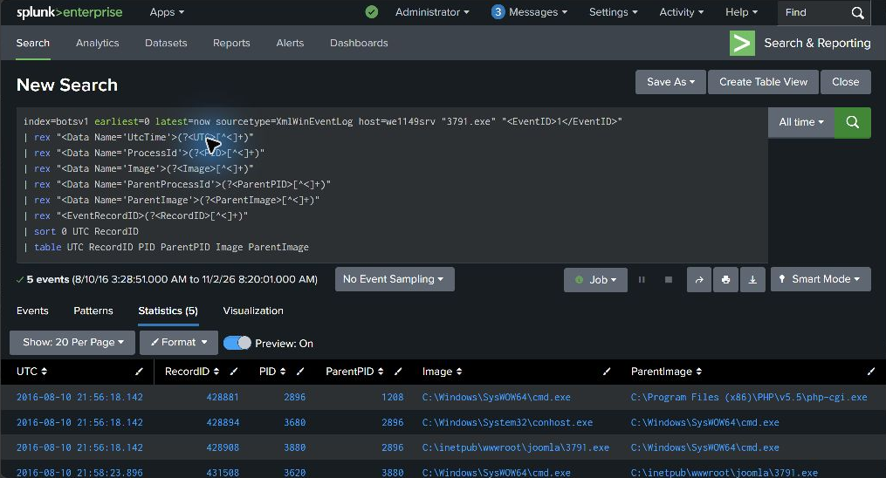
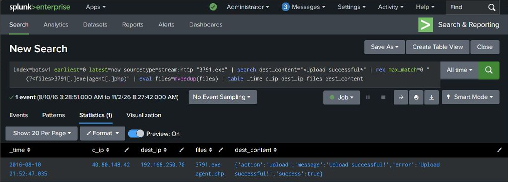

# Splunk SOC Home Lab: BOTS v1 Remote Code Execution Investigation

An evidence-led investigation of a Joomla server compromise using HTTP telemetry, Windows Security events, and Sysmon in Splunk.

**Outcome:** confirmed process execution of an uploaded executable through a PHP-to-command-shell process chain. This is a simulated BOTS training incident, not a production incident response engagement.

## Start here

- [Investigation report](reports/investigation.md): findings, UTC timeline, process lineage, and limitations.
- [Evidence register](evidence/README.md): provenance and a claim-to-evidence map.
- [SPL query library](queries/README.md): reproducible searches and their validation status.
- [Lab documentation](reports/home-lab.md): observed configuration and user-reported environment.

## Investigation at a glance

| Question | Evidence-supported answer |
|---|---|
| Which system executed the file? | `we1149srv`; `C:\inetpub\wwwroot\joomla\3791.exe` |
| What established execution? | Sysmon Event ID 1, record `428908`, corroborated by Security Event ID 4688 |
| What was the process chain? | `php-cgi.exe` (PID 1208) → `cmd.exe` (2896) → `3791.exe` (3880) |
| When? | 2016-08-10 21:56:18.142 UTC, from Sysmon `UtcTime` |
| What preceded it? | A successful upload response for `3791.exe` and `agent.php`, then requests to `/joomla/agent.php` |
| What remains uncertain? | Exact initiating command payload, initial credential acquisition, actor identity, persistence, and exfiltration |

The screenshot is a cropped capture of the live Splunk query results. The complete five-row result is preserved in [process-lineage.csv](evidence/process-lineage.csv).

The application reported both uploaded filenames and `success:true`; endpoint events establish that the executable subsequently ran.

## SOC skills demonstrated

- Pivoting from suspicious HTTP activity to endpoint process creation.
- Correlating parent and child PIDs and process GUIDs.
- Separating failed probes, successful upload responses, and confirmed execution.
- Normalizing event time with explicit UTC fields and documenting source-specific timestamp behavior.
- Writing an analyst handoff with evidence references, confidence, and proposed response actions.

## Reproduce the investigation

Use an authorized Splunk instance with the [Splunk BOTS v1 dataset](https://github.com/splunk/botsv1) indexed as `botsv1`. Run the numbered files in [queries](queries/README.md). Select **All time**, disable event sampling, and wait for **Complete** before reading results. Searches include explicit time boundaries.

This repository contains selected evidence excerpts and derived tables, not the complete dataset, malware binaries, session cookies, or local Splunk configuration. See the [evidence handling notes](evidence/README.md).

## Portfolio context

This project demonstrates entry-level SOC investigation and reporting skills through a home lab exercise. The evidence was reviewed with AI assistance against the user's live Splunk instance on November 2, 2026. It does not claim professional employment, certification, independent authorship of every query, or that containment actions were performed.

## Attribution

Dataset: Splunk, [Boss of the SOC v1](https://github.com/splunk/botsv1). Splunk and BOTS are names of their respective owners. Original analysis and queries are separate from the underlying training data; see [NOTICE.md](NOTICE.md).
